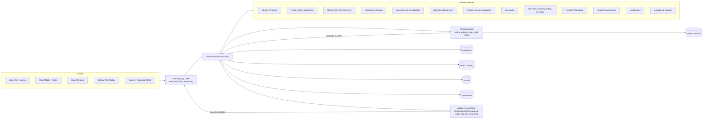

# FindMyDentist (FMD): End-to-End Product & Build Plan

| | |
|---|---|
| **Version** | 1.0 (draft for review) |
| **Date** | 8 Oct 2026 |
| **Owner** | klath (FMD) |
| **Sources** | FMD Master PDR (2 Oct 2026) + Expanded Product & Technical Annex (4 Oct 2026); web design references shared 8 Oct 2026 (3 monochrome homepage variants, 1 amber homepage variant, Carlos Digital Dental Studio page); earlier FMD design work (v3–v5: 3D glass tooth, Denti mascot, black + royal blue theme) |
| **Audience** | Founders, product, design, engineering, QA, operations |

> **How to read this document.** Sections 1–3 explain *what* we are building and *for whom*. Sections 4–6 define *how it looks and behaves* (design system, screens, features). Sections 7–16 define *how it is built and run* (AI, architecture, data, APIs, security, quality). Sections 17–20 define *how it is delivered* (phases, team, risks, open decisions). Anything marked **Decision needed** is not settled in the PRD and must be confirmed by FMD before that piece is built. Anything marked **Proposed** is this plan's recommendation.

---

## Table of contents

1. [Executive summary](#1-executive-summary)
2. [Products, users and roles](#2-products-users-and-roles)
3. [Business model, pricing and entitlements](#3-business-model-pricing-and-entitlements)
4. [Design analysis of the reference images](#4-design-analysis-of-the-reference-images)
5. [FMD design system ("Obsidian")](#5-fmd-design-system-obsidian)
6. [Information architecture and screens](#6-information-architecture-and-screens)
7. [Feature specifications by product](#7-feature-specifications-by-product)
8. [AI system design and boundaries](#8-ai-system-design-and-boundaries)
9. [Technical architecture](#9-technical-architecture)
10. [Data model](#10-data-model)
11. [API design](#11-api-design)
12. [Roles and permissions](#12-roles-and-permissions)
13. [Payments, billing and finance](#13-payments-billing-and-finance)
14. [Notifications and communications](#14-notifications-and-communications)
15. [Localisation and accessibility](#15-localisation-and-accessibility)
16. [Security, privacy and compliance](#16-security-privacy-and-compliance)
17. [Non-functional requirements and observability](#17-non-functional-requirements-and-observability)
18. [Analytics and BI](#18-analytics-and-bi)
19. [Testing and quality](#19-testing-and-quality)
20. [Delivery plan: phases and milestones](#20-delivery-plan-phases-and-milestones)
21. [Team, process and handover](#21-team-process-and-handover)
22. [Risks and mitigations](#22-risks-and-mitigations)
23. [Open decisions](#23-open-decisions)
24. [Appendices](#24-appendices)

---

## 1. Executive summary

**FindMyDentist (FMD)** is a dentistry-only ecosystem for India that connects **patients, dentists, clinics, dental students and dental companies** through AI-led guidance, discovery, content, clinic operations, academic tools and human care coordination. Everything ships under one FMD brand; the AI is "FMD AI", never the model vendor's brand.

**What we are building (6 surfaces, one platform):**

| # | Surface | One-line purpose | Primary platform |
|---|---|---|---|
| 1 | **FMD Main** | AI-first consumer and professional app: AI companion, find & book dentists, records vault, content feed, jobs, memberships | **Web (Next.js, the design in this doc)** + **mobile (Flutter)** |
| 2 | **FMD Concierge** | Premium enquiry form inside Main; a human FMD coordinator follows up | Inside Main (web + mobile) |
| 3 | **FMD Clinic OS** | Practice management + agentic **AI Clinic Manager** (the core USP) | Web app (desktop-first) + Flutter companion (Proposed) |
| 4 | **FMD Scholar** | Academic AI workspace for dental students | Web + Flutter (Proposed) |
| 5 | **FMD Admin** | Internal ops: verification, moderation, entitlements, Concierge queue, flags, audit | Web (Next.js) |
| 6 | **Accountant Portal** | Finance-only workspace inside Admin: ledgers, GST/TDS, reconciliation, close | Web (Next.js), MFA |

> **FMD Campus has been deleted.** It must never appear in navigation, estimates or designs.

**The three non-negotiables:**
1. **Public AI advises; it never acts.** FMD AI in Main never books, pays, messages a clinic or submits anything for a user. Every consequential action is confirmed by the user on a preview screen.
2. **Clinic AI acts only within approvals.** The Clinic Manager executes tasks through task cards with a fixed lifecycle and an autonomy matrix; it never makes clinical decisions and never moves money without human authorisation. Clinic OS must work fully when AI is down.
3. **Trust is visible.** Verified vs Sponsored/Featured, AI draft vs verified decision, estimate vs actual, and "availability needs confirmation" are always labelled, never colour-only.

**Design direction (from the images):** a **black, glassy, cinematic** web UI: a glossy 3D tooth rising over a glowing planet horizon, a centred gradient headline, a floating glass "Hi, I'm FMD AI" card, a pill search bar with location, specialty chips, four quick-action cards, top-rated dentist cards and popular treatment tiles. Accent colour: **royal blue** (from the latest FMD direction), with silver-white highlights. The Denti mascot (v5) is the AI's face inside chat and empty states.

---

## 2. Products, users and roles

### 2.1 User types and their jobs to be done

| User | Pays | Main jobs to be done | Surfaces |
|---|---|---|---|
| **Patient** (and caregiver) | Free | Understand a dental problem in my language; find a trusted dentist near me; book and manage visits; keep my reports in one place; get human help for complex care | Main, Concierge |
| **Dentist** (professional) | ₹550/yr | Be discovered; manage profile and availability; publish content; find jobs; access clinical knowledge | Main, Clinic OS (via clinic) |
| **Dental student** | ₹400/yr | Clear doubts, revise, prepare viva, build seminar decks, do research | Main, Scholar |
| **Dental company / corporate** | ₹2,000/yr | Brand presence, post jobs, publish sponsored content, reach dentists | Main |
| **Clinic owner / admin** | ₹2,000/month (Clinic OS) | Run the practice: calendar, patients, billing, inventory, staff; delegate work to the AI manager | Clinic OS |
| **Clinic staff** (front desk, assistant, hygienist) | Included in clinic plan | Check-ins, scheduling, collections, tasks | Clinic OS |
| **FMD operations / support / moderator** | Internal | Verify accounts, moderate content, run Concierge, handle support | Admin |
| **FMD super admin** | Internal | Configure plans, flags, roles; audit | Admin |
| **Accountant** | Internal | Independent month-close and statutory preparation | Accountant Portal |

### 2.2 Personas used for design and testing

| Persona | Context | Design implication |
|---|---|---|
| **Priya, 29, Bengaluru, IT professional** | Sensitive tooth, wants a dentist near office this week | Fast search, live "next available", clear fees |
| **Ramesh, 58, Vijayawada, Telugu speaker** | Son books for him; low familiarity with apps | Telugu UI + voice, large type, caregiver access |
| **Dr. Sneha, 34, implantologist** | Owns a 2-chair clinic, no receptionist on Sundays | AI manager handles recalls and reminders with approvals |
| **Arjun, 21, BDS 3rd year** | Viva next week, seminar on periodontitis | Scholar viva mode + PPT generator with citations |
| **Meena, clinic front desk** | 40 patients a day, interrupted constantly | Dense, keyboard-friendly calendar and quick check-in |
| **Kavya, FMD accountant** | Month-end GST and reconciliations | Exceptions queue, evidence attached to every entry |

### 2.3 Account and organisation model

- One **User** (person) can hold multiple **Memberships** in **Organisations** (a clinic tenant, a company, FMD itself).
- A user has one primary **account type** on Main (patient / dentist / student / company) that drives the membership and entitlements; a dentist can also be staff in one or more clinics.
- **Clinic OS tenant = Clinic organisation**, with one or more **Branches**. Every Clinic OS record is scoped by `org_id` (and `branch_id` where relevant).
- **Decision needed:** whether the ₹550/yr professional account is per dentist or per clinic, and how a Main clinic profile links to a Clinic OS tenant (Proposed: per dentist; a Clinic OS tenant automatically owns and syncs its public clinic profile, hours and bookable slots).

---

## 3. Business model, pricing and entitlements

| Plan | Price (INR, excl. GST) | Includes | Notes |
|---|---|---|---|
| Patient | Free | AI companion, discovery, booking, records vault, feed | Fair-use limits on AI and storage (Decision needed: values) |
| Dentist / professional (Main) | ₹550 / year | Verified profile, availability, content publishing, jobs, professional AI | Verification required |
| Student | ₹400 / year | Main student features + **FMD Scholar** within usage limits | Student ID verification; renewal and grace rules TBD |
| Scholar upgrade | ~₹350 (tentative) | More usage when limits are exhausted | **Decision needed:** period and exact benefit |
| Dental company / corporate | ₹2,000 / year | Company page, job posts, sponsored content tools | Sponsored content always labelled |
| Clinic OS | ₹2,000 / month | Full practice management + AI Clinic Manager (fair use) | Separate from Main professional membership |
| Concierge | **TBD** | Human coordination | Fees, areas, SLA not finalised |

**Purchase rules (from the PRD, apply everywhere):**
- Before purchase, show price, GST, total, renewal date/terms, usage limits and refund terms. No hidden charges.
- Show a **usage meter** before users hit a limit, with a clear upgrade path. No surprise hard stops.
- Entitlements are computed server-side from active subscriptions (`entitlements` service); clients never decide access.
- GST invoices for every FMD charge; clinic treatment fees are **not** FMD revenue unless a contract says so.

---

## 4. Design analysis of the reference images

Five references were shared. Images 1–3 are three iterations of the same FMD homepage in a cool monochrome palette; image 4 is the same layout with a warm amber accent; image 5 (Carlos Digital Dental Studio) is a black, premium single-page site used as a secondary layout and mood reference.

### 4.1 What the FMD homepage references establish

| Element | What the images show | What we adopt |
|---|---|---|
| **Canvas** | Near-black background (#000–#0A0A0C) with soft vignette, star dust and subtle light rays | Black base with layered radial glows; no flat grey |
| **Hero object** | A glossy, porcelain-white 3D molar rising out of a planet surface; a bright atmospheric rim light arcs across the page behind it | 3D glass/porcelain tooth (existing three.js renderer from v4/v5) sitting on a glowing planet horizon arc; slow idle rotation + float |
| **Headline** | Small tracked eyebrow "AI-POWERED DENTAL CARE"; two-line display headline "Better Oral Health / Starts **Here.**" with a silver-to-white gradient, last word emphasised | Display type 64–72 px, tight tracking, gradient fill; key word in white (or accent) |
| **Sub-copy** | One centred sentence, 2 lines, muted grey-white | 18 px, 70% white |
| **Navigation** | Logo "FMD" wordmark + "FindMyDentist"; centre links: Find Dentists, Treatments, AI Assistant, For Clinics, For Students, More ▾; right: search icon, location pill (Bengaluru ▾), bell with unread dot, avatar. Image 3 puts the nav in a thin glass bar | Glass top bar, sticky, condenses on scroll |
| **Stats rail (left)** | 10K+ Verified Dentists, 50K+ Happy Patients, 4.9★ Average Rating, each with a line icon in a glass square | Stats rail; values come from live data (never hard-coded marketing numbers) |
| **AI card (right)** | Glass card "Hi, I'm FMD AI. Ask about symptoms, treatments or find the right dentist for you." + white circular arrow; image 3 adds a voice waveform and four prompt chips (Analyse Symptoms, Compare Treatments, Find a Dentist, Prepare for Appointment) | Floating AI entry card with voice button + 4 chips. Wording note: "Analyse Symptoms" is changed to **"Understand Symptoms"** to stay educational (no diagnosis) |
| **Value ladder** | Vertical tracked text "DISCOVER / COMPARE / CONSULT / BOOK / ALL IN ONE PLACE" with a hairline | Decorative, `aria-hidden`, desktop ≥1280 px only |
| **Search bar** | Large pill: search icon, "Search dentists, treatments or clinics…", divider, location selector, solid white circular go-button | The single most important control; also sticky in header after scroll |
| **Specialty chips** | Row of glass chips with tooth icons: General Dentist (selected, brighter glass), Orthodontist, Implantologist, Periodontist, Cosmetic Dentist, Pediatric Dentist, Oral Surgeon, Teeth Cleaning, More | Horizontal scroll-snap row; selected = filled glass + rim light |
| **Quick actions** | 4 wide glass cards: Find Dentists Near You / Understand Treatments / AI Dental Assistant / Book Appointments, each with icon tile, title, one-line, arrow | 4-up grid → 2-up tablet → stacked mobile |
| **Dentist cards** | Photo, ★ rating (count), name, specialty, area + distance, 2 service tags, heart (save), "Next available: Today, 5:30 PM", full-width white **View Profile** pill (image 3 uses a small circular arrow instead) | Dentist card component; add **Verified** badge and **Sponsored** label slot (PRD) |
| **Popular treatments** | 4 horizontal tiles with a photo/3D render, title, one-liner, arrow | Treatment tile component linking to the treatment library |
| **Section headers** | Left title, right "View All →" | Standard section header |

**Accent variants.** Images 1–3 are monochrome with a cool silver-blue rim light; image 4 uses a warm amber/orange glow and amber icon tiles. Per the latest agreed FMD direction (v5), the **default accent is royal blue**, applied the way the cool variant applies its glow. The amber variant is kept as an **optional "Ember" theme token set** (e.g. for campaigns), not as the default.

### 4.2 What the Carlos studio page contributes

- **Premium editorial sections** below the fold: split hero with circular image crop, a bordered "about" panel (text + product photo + vision/mission), 3×2 service grid with circular product thumbnails, an "Our Approach" section with a central 3D object and four labelled benefits around it, a contrasting grey CTA band, and a centred footer with contact icons.
- We use these patterns for **marketing pages**: *For Clinics* (Clinic OS), *For Students* (Scholar), *Concierge*, *About*, and *Treatment detail* pages, and for the homepage's lower sections (How FMD works, Why trust FMD, CTA band, footer).
- We do **not** adopt its serif display font; FMD stays with one geometric sans for consistency.

### 4.3 Gaps the images do not cover (filled by this plan)

Light theme, mobile layouts, logged-in states, all inner pages, Clinic OS / Scholar / Admin, error/empty/loading states, labelling for Verified vs Sponsored, accessibility contrast. Sections 5 and 6 define these.

---

## 5. FMD design system ("Obsidian")

### 5.1 Principles

1. **One hero glow per screen.** Light is the brand; use it to point at the one thing that matters.
2. **Glass for containers, solid for actions.** Cards are translucent; primary actions are solid white (dark theme) or solid royal blue.
3. **Calm density.** Marketing and patient screens breathe; Clinic OS and Admin are dense, quieter and default to light theme.
4. **Trust labels are components, not text.** Verified, Sponsored, AI draft, Estimate, Needs confirmation each have one fixed component.
5. **Every state is designed.** Loading, empty, error, success and recovery exist for every screen (PRD Definition of Done).

### 5.2 Colour tokens

Dark is the default for Main web, Main mobile and Scholar. Light is a full twin (user-selectable, follows OS by default). Clinic OS, Admin and Accountant default to light.

| Token | Dark | Light | Use |
|---|---|---|---|
| `--bg` | `#020308` | `#F6F7FB` | Page background |
| `--bg-elev` | `#0B0D14` | `#FFFFFF` | Solid surfaces (menus, modals) |
| `--glass` | `rgba(255,255,255,0.05)` | `rgba(255,255,255,0.72)` | Card fill |
| `--glass-strong` | `rgba(255,255,255,0.10)` | `rgba(255,255,255,0.90)` | Selected chip, hover |
| `--glass-border` | `rgba(255,255,255,0.10)` | `rgba(10,20,60,0.10)` | 1 px card borders |
| `--rim` | `linear-gradient(135deg, rgba(255,255,255,.35), rgba(255,255,255,.04) 40%)` | `linear-gradient(135deg, rgba(36,72,240,.25), transparent 40%)` | Gradient edge on glass |
| `--text` | `#F5F7FF` | `#0A0F1F` | Primary text |
| `--text-2` | `rgba(245,247,255,0.70)` | `#3B4256` | Secondary text |
| `--text-3` | `rgba(245,247,255,0.50)` | `#6A7184` | Tertiary/meta (≥ 4.5:1 checked at 14 px+) |
| `--accent` | `#2448F0` | `#2448F0` | Royal blue: filled accent buttons, focus, AI |
| `--accent-text` | `#8FA4FF` | `#1F3FD6` | Accent used as text/icons on bg |
| `--accent-glow` | `rgba(36,72,240,0.55)` | `rgba(36,72,240,0.25)` | Horizon arc, halos |
| `--cta` | `#FFFFFF` on `#020308` text | `#0A0F1F` on white text | Primary pill CTA (as in the images) |
| `--verified` | `#34D399` | `#0E9F6E` | Verified badge (always with icon + text) |
| `--sponsored` | `#F5B83D` | `#A86B00` | Sponsored/Featured label |
| `--ai-draft` | `#8FA4FF` | `#1F3FD6` | "AI draft" chip (dashed border) |
| `--warning` | `#FBBF24` | `#B45309` | Needs confirmation, estimates |
| `--danger` | `#F87171` | `#C81E1E` | Errors, destructive |
| `--star` | `#F5B83D` | `#D18A00` | Rating stars |

Contrast rule: royal blue `#2448F0` is never used as text on black (2.6:1); use `--accent-text` instead. White on `#2448F0` is ≈ 8:1 and is fine for buttons.

**Ember theme (optional, from image 4):** `--accent: #FF8A3D`, `--accent-text: #FFB27A`, `--accent-glow: rgba(255,138,61,.5)`, icon tiles with amber inner glow. Off by default.

### 5.3 Typography

| Role | Font | Size / line height (desktop) | Weight |
|---|---|---|---|
| Display (hero) | **Plus Jakarta Sans** (Latin) | 72/76, tracking −2% | 600, key word 700 |
| Eyebrow | Plus Jakarta Sans | 12/16, tracking +40%, uppercase | 500 |
| H1 / H2 / H3 | Plus Jakarta Sans | 40/48 · 28/36 · 20/28 | 600 |
| Body L / Body / Small | Plus Jakarta Sans | 18/28 · 16/24 · 14/20 | 400 |
| Numbers (stats, prices) | Plus Jakarta Sans, tabular figures | as context | 600 |
| Indian scripts | **Noto Sans Telugu / Kannada / Tamil / Devanagari** | +2 px size, +10% line height vs Latin | 400/600 |

Mobile display size is 40/44. All sizes in `rem`, respecting OS text scaling up to 200% without clipping.

### 5.4 Spacing, radius, elevation

- **Spacing scale (px):** 4, 8, 12, 16, 20, 24, 32, 40, 56, 72, 96. Page gutter 24 (desktop 80, max content width 1360).
- **Radius:** chips & pills 999; buttons 999; cards 20; large panels 28; inputs 16; avatars full.
- **Glass recipe:** `background: var(--glass); backdrop-filter: blur(20px) saturate(140%); border: 1px solid var(--glass-border);` plus a 1 px gradient rim via `mask` and an inner top highlight `inset 0 1px 0 rgba(255,255,255,.08)`.
- **Elevation:** no hard drop shadows on dark; depth comes from blur + rim + glow. Light theme uses `0 8px 30px rgba(10,20,60,.08)`.
- **Fallback:** where `backdrop-filter` is unsupported or "Reduce transparency" is on, glass becomes solid `--bg-elev`.

### 5.5 The hero scene (signature visual)

- **Planet horizon:** a large ellipse below the fold line with a bright rim (`--accent-glow` mixed with white), soft atmospheric bloom and faint surface texture. Built as layered CSS radial gradients + one SVG arc (cheap, crisp, theme-able).
- **3D tooth:** the existing three.js porcelain/glass molar renderer (`designs/v4/tooth-renderer-threejs.html`, `designs/v5-mascot/denti-renderer-threejs.html`) productionised as a React Three Fiber component:
  - Desktop: live WebGL, idle Y-rotation 0.08 rad/s, ±6 px float, subtle pointer parallax, bloom on rim.
  - Mobile / low-end / `prefers-reduced-motion` / WebGL unavailable: pre-rendered animated **WebP/AVIF loop** (≤ 600 KB) or a static still.
  - Lazy-load the 3D bundle after first paint; LCP element is the headline, not the canvas.
- **Light theme hero:** pearl-white backdrop, the horizon becomes a soft royal-blue dawn arc, tooth keeps porcelain material with cooler reflections.

### 5.6 Denti, the AI mascot

The v5 mascot (porcelain molar with black glass visor, royal-blue LED eyes) is FMD AI's face **inside** the product: chat avatar, voice listening state (equaliser eyes), empty states, onboarding, Scholar (grad cap pose), success (happy pose). The homepage hero keeps the clean realistic tooth from the references; Denti appears in the AI card and the AI Assistant page. **Decision needed:** confirm the name "Denti".

### 5.7 Core components

| Component | Spec highlights |
|---|---|
| **TopNav** | Glass bar 72 px; logo, 5 links + More, search, location pill, notifications (dot), avatar menu; condenses to 56 px with search field on scroll; mobile: logo + search + menu sheet |
| **SearchBar (hero)** | 64 px pill; query input with typeahead (dentists, clinics, treatments, specialties); location selector (GPS or city); white go-button; keyboard: `/` focuses |
| **Chip / SpecialtyChip** | Icon + label; selected = `--glass-strong` + rim; scroll-snap row with fade edges and arrow buttons on desktop |
| **QuickActionCard** | Icon tile (48 px glass square) + title + one-liner + arrow; whole card clickable; hover lifts 2 px and brightens rim |
| **DentistCard** | Photo 96 px, rating, name, specialty, area + distance, ≤ 2 service tags, save heart, next-available row with calendar icon, View Profile pill; slots: `VerifiedBadge`, `SponsoredLabel`, `AvailabilityState` (live / needs confirmation / unavailable) |
| **TreatmentTile** | Image left (3D renders preferred), title, one-liner, arrow |
| **AIEntryCard** | Glass card, Denti/sparkle icon, greeting, mic button, send arrow, 4 prompt chips |
| **StatItem** | Icon square + value + label |
| **Badges** | `Verified ✓`, `Sponsored`, `Featured`, `AI draft`, `Estimate`, `Needs confirmation`, statuses (Booked, Pending, Cancelled, Completed); always icon + text |
| **ConfirmSheet** | The mandatory preview before any consequential action: summary rows, fees, terms, primary "Confirm" + secondary "Edit" |
| **TaskCard (Clinic AI)** | Request, plan steps, status, approvals needed, preview, result, follow-ups, audit link |
| **Buttons** | Primary (white pill on dark / ink pill on light), Accent (royal blue), Secondary (glass), Ghost, Destructive; 44 px min height |
| **Inputs** | Glass fields, visible labels (no placeholder-only), inline errors with icon |
| **Data table** (Clinic OS/Admin) | Light theme, sticky header, column filters, row density toggle, bulk actions |
| **Odontogram** | FDI notation 11–48 (adult) and 51–85 (primary), per-surface (M/O/D/B/L) charting, condition legend with patterns + colours |
| **States** | Skeletons that match final layout, empty states with Denti + next action, error with retry and support link |

### 5.8 Motion

| Pattern | Spec |
|---|---|
| Page entrance | Fade + 12 px rise, 400 ms, ease-out, 40 ms stagger per card |
| Hover | 150 ms; lift 2 px, rim brightens, arrow nudges 3 px |
| Hero | Tooth idle rotation/float; horizon glow "breathes" (opacity 0.85↔1, 6 s) |
| AI listening | Denti eyes become an equaliser; waveform in the AI card |
| Streaming answers | Token stream with a soft caret; tool steps appear as chips |
| Reduced motion | All of the above off except opacity fades ≤ 150 ms |

Implementation: Framer Motion (web), Flutter implicit animations + Rive/Lottie for Denti poses (mobile).

### 5.9 Iconography and imagery

- Line icons, 1.5 px stroke, rounded caps: **Lucide** base + a custom **dental icon set** (molar, braces, implant, veneer, child tooth, scalpel, cleaning sparkle, odontogram) drawn on the same grid.
- Treatment imagery: consistent 3D renders on dark/neutral backgrounds (as in "Popular Treatments"). Dentist photos: real, verified, consistent crop; never stock photos presented as real dentists.
- No identifiable patient imagery without recorded consent (PRD).

### 5.10 Responsive breakpoints

| Name | Width | Layout notes |
|---|---|---|
| `sm` | < 640 | Single column; stats rail becomes a 3-up row under the headline; AI card becomes a floating "Ask FMD AI" button; chips scroll |
| `md` | 640–1023 | 2-up cards; nav collapses into menu |
| `lg` | 1024–1279 | Full nav; stats and AI card sit above the search |
| `xl` | ≥ 1280 | Layout exactly as references: stats left, AI card right, value ladder visible |

---

## 6. Information architecture and screens

### 6.1 FMD Main (web) sitemap

```
/                         Home (reference design)
/search                   Find Dentists (results: list + map)
/dentists/[slug]          Dentist profile
/clinics/[slug]           Clinic profile
/book/[slotId]            Booking flow (details → review → confirm → done)
/treatments               Treatment library
/treatments/[slug]        Treatment detail (Carlos-style editorial)
/ai                       FMD AI Assistant (chat, voice, uploads)
/explore                  Content feed (reels, posts, polls)
/jobs, /jobs/[id]         Jobs board
/concierge                Concierge landing + enquiry form
/for-clinics              Clinic OS marketing + trial/demo
/for-students             Scholar marketing + membership
/membership               Plans, current status, usage, renewal
/account/...              Profile, appointments, records vault, saved, settings, privacy, language, delete account
/pro/...                  Professional dashboard (profile, availability, content, jobs, claim profile)
/company/...              Company page, job posts, sponsored content
/help, /legal/...         Help centre, terms, privacy, AI disclosure, refund policy
```

**Mobile (Flutter) bottom nav:** Home · Search · **AI** (centre, Denti) · Explore · Me. Records, appointments, membership and Concierge live under Me and in the AI's suggested actions.

### 6.2 Home page, section by section

1. **TopNav** (glass, sticky).
2. **Hero:** eyebrow, gradient headline, sub-copy, 3D tooth on planet horizon, left stats rail (live counts), right AI entry card with 4 chips, value ladder, **hero search bar**.
3. **Specialty chips** row (General Dentist, Orthodontist, Implantologist, Periodontist, Cosmetic Dentist, Pediatric Dentist, Oral Surgeon, Teeth Cleaning, More). Selecting a chip filters the dentist cards below in place and updates the "View All" link.
4. **Quick actions:** Find Dentists Near You → `/search`; Understand Treatments → `/treatments`; AI Dental Assistant → `/ai`; Book Appointments → `/search?available=today`. "Book Appointments" says **"Live availability where clinics share it"** instead of the reference's "Real-time availability" so the claim stays accurate (PRD: show live only from a reliable source).
5. **Top Rated Dentists Near You:** 4 cards (8 on wide screens via carousel). Ranking: verified first, then distance, rating with minimum review count, availability. Sponsored cards (if any) are visibly labelled and capped (e.g. 1 in 4).
6. **Popular Treatments:** 4 tiles.
7. **How FMD works** (Carlos "Our Approach" pattern): tooth in the centre, four steps around it: Understand → Discover → Book → Manage records.
8. **For patients who need help: Concierge** band (glass panel, ember-free; royal-blue rim).
9. **From the Explore feed:** 6 trending reels/posts (sponsored labelled).
10. **For Clinics / For Students** split CTA band.
11. **Trust strip:** verification explained, privacy promise, AI disclaimer ("FMD AI gives information, not diagnosis").
12. **Footer** (Carlos pattern): links, languages, app store badges, contact, social, legal.

**Logged-in variant:** greeting, "Up next" appointment card replaces the stats rail; recent AI conversation resume in the AI card; reminders strip.

### 6.3 Main screens inventory

| Area | Screens |
|---|---|
| Onboarding | Welcome, language picker, phone/email + OTP, account type (patient/dentist/student/company), consent (terms, privacy, AI, health data), profile basics, verification upload (pro/student/company), membership purchase |
| AI | Chat home (Denti, suggestions), conversation, voice mode, image/document upload + explanation, history, saved answers, escalation card ("This needs a dentist soon"), budget worksheet, insurance explainer, report summary, checklists |
| Discovery | Search results (list/map, filters: specialty, service, distance, availability, language, fee range, gender, verified only), dentist profile, clinic profile, compare (up to 3), saved |
| Booking | Slot picker, patient details (self/family member), booking summary (provider, time, clinic, fee, cancellation terms) → **explicit confirm**, success with reference, appointment detail, reschedule, cancel, failure/recovery |
| Records | Vault (by date/clinic/provider/episode/type), upload with progress, document viewer, share with provider (scope + expiry), access history, storage meter |
| Journey | Treatment journey timeline (Annex B), warranty certificates (Annex A) with QR verify |
| Explore | Feed (For you / Following / Learn), reel player, post, poll, creator profile, comments, report, "Why am I seeing this" |
| Jobs | Browse, filters, job detail, apply, my applications; post a job (pro/company), manage posts |
| Concierge | Landing, enquiry form, received screen with reference no., status tracker |
| Membership | Plans, checkout (price + GST + renewal + refund), status, benefits, usage meters, renewal, invoices |
| Professional | Dashboard, profile editor, verification status, availability rules, claim profile, content studio, analytics |
| Settings | Language, theme, notifications, privacy & consents, connected devices, data export, delete account |
| Feedback | Rate a visit (private feedback + optional public review), my reviews |

### 6.4 Clinic OS screens (desktop-first web, light theme default)

Layout: left icon rail (Dashboard, Calendar, Patients, Billing, Inventory, Tasks, AI Manager, Reports, Content, Settings), top bar with branch/date switcher, global search, **AI command bar (⌘K / Ctrl+K)**, notifications.

| Area | Screens |
|---|---|
| Onboarding | Clinic signup, onboarding dashboard (checklist + progress), branches, hours, services & fees, staff invites & roles, comms channels, AI permissions/approval thresholds, data migration wizard (CSV upload → map → validate → sample review → sign-off → import → reconcile → rollback) |
| Dashboard | Today's appointments, check-ins, no-shows, pending confirmations, follow-up queue, collections today, outstanding, inventory alerts, AI tasks needing approval, configurable widgets, branch/date filters |
| Calendar | Day/week/month, by provider or chair, drag to reschedule with conflict checks, waitlist, statuses (booked, confirmed, arrived, in chair, completed, no-show, cancelled), reminders state, online bookings from Main flagged |
| Patients | List with duplicate detection, registration, patient 360 (timeline, demographics, medical alerts, consents), clinical notes (sign + amend only), **odontogram** with history, treatment plans & estimates (versioned, patient acceptance), attachments, warranty issuance |
| Billing | Estimates, invoices (GST where applicable), partial payments, refunds, payment links, daily collection sheet, outstanding ageing |
| Inventory | Items, stock levels, batches & expiry, reorder points, purchase orders (AI can draft), suppliers |
| Staff | Tasks & handover notes, roles, shifts (light) |
| **AI Manager** | Chat + voice, task cards list (Needs approval / Running / Scheduled / Done / Failed), task detail (plan, preview, approve/edit/reject), recurring tasks, review queue, task history & audit, AI settings & usage meter |
| Content | Content studio (AI drafts posts/reels scripts), approval, publish to FMD Main, performance |
| Reports | Appointments, utilisation, recall completion, collections, outstanding, treatment mix, AI task stats; export |
| Support | Help centre, raise ticket, ticket status |
| Settings | Clinic profile (syncs to Main), billing & plan, integrations, templates, consent forms, audit log |

### 6.5 Scholar screens

Home (Denti in grad cap, continue where you left off, usage meter), Ask (doubt clarification with level selector: Beginner / UG / PG / Specialist), Quiz, Flashcards, Revision planner, **Viva practice** (voice), Ask-your-docs (upload PDFs, answers cite page numbers), **Presentation builder** (topic, type: seminar/journal club/case, slide count, style, citations on/off, speaker notes; per-slide regenerate; export editable PPTX/PDF), Research workspace (question framing, literature search plan, comparison matrix, methodology, manuscript/abstract/poster drafts, reviewer responses), Projects & library (chats, docs, outputs, tags), Usage & upgrade. Every research output shows an **academic integrity** reminder and a **"verify citations"** flag.

### 6.6 Admin and Accountant screens

**Admin:** platform dashboard, users & orgs, verification queues (dentist/student/company/clinic, with document viewer and decision + reason), moderation queues (content, reviews, jobs, reports, appeals), sponsored/ads manager, plans & entitlements, Concierge queue (statuses below), support tickets, feature flags, AI configuration (models per feature, prompts versions, safety rules, cost caps), templates (notifications, consents), audit log, roles & access.

**Concierge queue statuses:** New → Contact Attempted → Contacted → Needs Clarification → Coordinating → Awaiting Patient → Confirmed → Closed / Cancelled.

**Accountant Portal:** finance dashboard, income ledgers per revenue stream (memberships, Clinic OS, Scholar upgrades, Concierge, sponsored), expenses, bank statement import + reconciliation, AR/AP, invoices & credit notes, GST (output, ITC, returns prep), TDS, filing calendar with evidence uploads, trial balance / P&L / balance sheet / cash flow, month-close checklist, exceptions queue, export to TallyPrime / Zoho Books, founder approval step. No clinical data visible; MFA mandatory; no storage of bank passwords, OTPs or DSC secrets.

---

## 7. Feature specifications by product

Each feature lists its key behaviours and acceptance criteria (AC). Feature IDs (e.g. `MAIN-AI-01`) are used for the traceability matrix required by the PRD.

### 7.1 FMD Main

**MAIN-ONB: Onboarding & identity**
- Phone OTP (primary) or email; account type selection; consents recorded with version + timestamp; profile; verification upload for pro/student/company.
- AC: a user can delete their account from settings, sees what is deleted vs retained (legal/financial), and receives confirmation.

**MAIN-AI: FMD AI companion**
- Inputs: text, voice (STT), images (e.g. tooth photo), documents (reports, X-ray images, insurance PDFs). Languages: English, Telugu, Kannada, Tamil, Hindi, mixed-language (e.g. Tanglish/Hinglish), with more later.
- Outputs: plain-language education, uncertainty statements, suggested next steps, **suggested actions as buttons** (e.g. "See implantologists near you", "Prepare questions for your visit"). Buttons navigate; they never execute.
- Red flags (facial swelling, fever with tooth pain, trauma, uncontrolled bleeding, difficulty breathing/swallowing) trigger an **escalation card**: seek urgent care, nearest open clinics, emergency number.
- Tools: treatment budget worksheet (all values labelled **Estimate**), insurance document explainer, report summariser, appointment/treatment-plan organiser, dental history, checklists & reminders (user-created).
- History: list, search, rename, delete; per-conversation feedback (helpful / not helpful + reason).
- AC: AI never states a diagnosis or prescribes medication/dosage; never creates a booking, payment, message or submission; every answer about a person's condition includes "see a dentist" guidance where relevant; switching language mid-chat works.

**MAIN-DISC: Discovery & profiles**
- Search by location, specialty, service, availability, language, fee, gender; list + map; sort by relevance, distance, rating, earliest availability.
- Profiles: photo, qualifications, registration number (verified), experience, services & indicative fees, languages, clinic(s), hours, photos, reviews, next available.
- **Verified** badge only after FMD verification; **Sponsored/Featured** visibly labelled and never disguised as organic ranking.
- Availability: shown as live only when sourced from Clinic OS or a reliable integration; otherwise "Request a time: needs confirmation".
- Claim-profile flow for unclaimed listings (proof of identity + registration).
- AC: a sponsored result can never display without the label; search results load in < 1.5 s p75 on 4G.

**MAIN-BOOK: Booking**
- Slot selection → patient (self or family member) → summary (provider, clinic, address, time, fee, cancellation terms) → **Confirm** (explicit tap) → status: *Booked* (Clinic OS instant) or *Requested* (needs clinic confirmation).
- Reminders, add to calendar, directions, reschedule/cancel within policy, graceful failure ("slot just taken, here are the next 3").
- Idempotency key on confirm; double-taps never create two bookings.
- AC: booking cannot complete without the summary screen; status shown matches clinic-side state.

**MAIN-REC: Records vault**
- Patient-owned; upload (camera, files), auto-organise by date/clinic/provider/episode/type with manual edit; viewer; share with a chosen provider with scope and expiry; revoke; access history; storage meter and limits.
- AC: files are encrypted at rest; share links expire; every access is logged and visible to the patient.

**MAIN-JOUR: Treatment journey & warranty (Annex A, B)**
- Timeline: discover → consult → estimate/plan → consent → treatment → payment/warranty → recall → closure/export; data comes from Clinic OS when linked, else patient-entered (labelled).
- Warranty certificates issued by clinics: ID + QR verification page; states active / expired / amended / voided / disputed / transferred.

**MAIN-FEED: Explore content**
- Reels, posts, education articles, polls, creator content; For you / Following; follow, like, comment, save, share, report; "Why am I seeing this" + reset personalisation (Annex D).
- Upload pipeline: transcoding (HLS), thumbnails, captions; moderation before or after publish by risk category; no identifiable patient cases without consent attestation.
- Content import only via official APIs/embeds/uploads with attribution (Annex C).

**MAIN-JOBS: Jobs board**
- Post (pro/company/clinic), browse, filters, apply (CV upload), status, moderation, expiry and renewal.

**MAIN-MEM: Memberships**
- Plan pages, checkout via payment gateway, GST invoice, status, benefits, renewal (auto-renew opt-in), usage meters, upgrade, failed payment recovery.

**MAIN-FB: Feedback & reviews (Annex G)**
- Post-visit prompt; private feedback to clinic and optional public review; structured topics; clinic responses; moderation and appeals. **Decision needed:** public reviews at launch.

### 7.2 FMD Concierge (inside Main)

- Form: contact preference (call/WhatsApp/email), area, dental need, preferred timing, notes, consent for contact; collect minimum health info with clear use statement.
- Result: reference number + "We've received your request" (never "confirmed"); status tracker visible to the patient.
- Internal queue in Admin with SLA timers, assignment, notes, call outcomes, linked bookings.
- AC: copy never implies FMD provides treatment or 24/7 service unless staffed.

### 7.3 FMD Clinic OS

| ID | Feature | Key acceptance criteria |
|---|---|---|
| CLN-SET | Setup & onboarding | Clinic can go live (hours, services, one provider, booking enabled) in under 30 minutes with the checklist |
| CLN-DASH | Dashboard | Widgets reflect real-time data; filter by branch/date; every widget has empty and error states |
| CLN-CAL | Calendar | No double-booking of provider or chair; conflicts explained; Main bookings appear instantly |
| CLN-PAT | Patients & charting | Duplicate detection on name+phone+DOB; signed notes are immutable, changes via amendments with reason and history; odontogram per surface with history |
| CLN-PLAN | Treatment plans & estimates | Versioned; patient-facing view; acceptance captured; estimate vs final invoice clearly separated |
| CLN-BILL | Billing | Partial payments, refunds with reason, payment links, daily collection sheet reconciles to payments |
| CLN-INV | Inventory | Batch & expiry; reorder alerts; POs drafted by AI require approval before sending |
| CLN-STAFF | Staff tasks & handover | Assign, due dates, handover notes per shift |
| CLN-REP | Reports | Export CSV/PDF; numbers match source screens |
| CLN-AI | AI Clinic Manager | See section 8.3 |
| CLN-CONT | Content to Main | AI drafts; human approves; published with clinic attribution |
| CLN-SUP | Support | Tickets with severity; status visible |
| CLN-MIG | Data migration (Annex F) | CSV first; validate → sample → sign-off → import → reconcile counts → rollback available |

**Offline/AI-down rule:** every Clinic OS workflow is completable without the AI. Calendar and check-in should tolerate brief connectivity loss (Proposed: optimistic UI + retry queue on web; local cache on mobile).

### 7.4 FMD Scholar

| ID | Feature | Key acceptance criteria |
|---|---|---|
| SCH-ASK | Doubt clarification by level | Answer depth changes with level; sources cited where retrieval is used |
| SCH-STUDY | Quizzes, flashcards, revision plans | Spaced repetition schedule; progress saved |
| SCH-VIVA | Viva practice | Voice Q&A; feedback on answers; transcript saved |
| SCH-DOCS | Ask your documents | Answers cite page numbers from uploaded PDFs; "not found in your documents" when absent |
| SCH-PPT | Presentation builder | Editable PPTX export; per-slide regenerate; speaker notes; citations list; style templates in FMD look |
| SCH-RES | Research help | Anti-fabrication: references must resolve (DOI/PubMed lookup) or be flagged "unverified"; integrity reminder on every output |
| SCH-WS | Workspace | Projects, saved chats, docs, outputs, tags, search |
| SCH-USE | Usage & upgrade | Meter per feature; warning at 80%; upgrade path; no silent hard stop |

### 7.5 FMD Admin and Accountant Portal

As listed in 6.6. Key ACs: every admin action is audit-logged with actor, before/after and reason; role changes require super admin; accountant cannot see clinical data or user health content; filing preparation is separated from founder approval.

---

## 8. AI system design and boundaries

### 8.1 Principles

- **Provider-agnostic.** All model calls go through the FMD **Model Gateway**; models are chosen per feature by config (quality, multimodality, Indian-language performance, data terms, cost). Fallback provider configured per feature.
- **FMD-branded.** The assistant is "FMD AI"; the vendor is never named in UI.
- **Tools, not free hands.** AI acts only through registered tools that call the same backend APIs as the apps, with the same permission checks, scoped to the acting user/clinic.
- **Grounded where it matters.** Retrieval over a curated, reviewed dental knowledge base (treatments, aftercare, FAQs) for Main; uploaded docs + academic sources for Scholar; clinic data for Clinic AI.
- **Observable.** Every AI request, tool call, approval and result is logged (prompt version, model, tokens, latency, cost, outcome), traceable by task ID.

### 8.2 FMD Main AI (advisory only)

| Allowed | Not allowed |
|---|---|
| Explain symptoms, conditions, procedures, costs (as estimates), aftercare | Diagnose, prescribe, recommend medication dosage |
| Summarise a user's uploaded report/insurance doc | Book, reschedule, cancel, pay, message a clinic, submit a form |
| Suggest specialties and show matching dentists (navigation links) | Rank a sponsored dentist above verified results without the label |
| Prepare questions/checklists for a visit | Claim certainty it does not have |
| Escalate red-flag symptoms to urgent care guidance | Give emergency triage beyond "seek care now" + nearest options |

**Tool registry (Main):** `search_dentists` (read), `get_treatment_info` (read), `summarise_document` (read user-owned file), `create_checklist` (writes only to the user's own notes, user-initiated), `open_screen` (deep link). There is deliberately **no** booking/payment/messaging tool in Main AI.

**Safety layers:** system policy, input classifier (emergency, self-harm, abuse, out-of-scope), output checker (diagnosis/prescription language, sponsored disclosure), mandatory disclaimer component, human feedback loop, red-team suite (section 19).

### 8.3 Clinic AI Manager (agentic, the USP)

**Modes:** chat, voice, task cards, scheduled/recurring tasks, review queue, task history, notifications (completed / partial / blocked / failed / approval needed).

**Lifecycle (every task):**

```
Receive → Clarify → Plan → Authorize → Preview → Execute → Verify → Report → Audit
```

**Task areas:** front desk (confirmations, waitlist fill), recall campaigns, daily payment sheets, content strategy and drafts, publishing to Main (approval), patient communication drafts, reports, inventory and PO drafts, staff coordination, doctor's personal assistant (schedule, reminders; "wellbeing check-ins" scope is a **Decision needed**), dental knowledge support.

**Default autonomy matrix (Proposed; FMD to approve):**

| Action class | Example | Default |
|---|---|---|
| Read & summarise | "How many no-shows this week?" | Auto |
| Create internal drafts | Draft recall message, draft PO, draft post | Auto (marked **AI draft**) |
| Templated reminders with valid consent & clinic policy | Appointment reminder via approved WhatsApp template | Auto (if enabled in settings) |
| External message (non-template) | Custom message to a patient | **Approval** |
| Patient-affecting appointment change | Reschedule/cancel a patient's visit | **Approval** |
| Publish to FMD Main | Post a case/reel | **Approval** (+ consent attestation) |
| Edit signed clinical record | Change a signed note | **Not allowed**; amendment flow only, by a human |
| Money movement | Refund, payment, discount | **Human performs**; AI may prepare |
| Clinical decision | Diagnosis, treatment selection | **Never** |

Approvals can be set per role and threshold (e.g. bulk messages > 20 recipients always need owner approval). Approvals expire; a stale preview must be regenerated.

**Task card data:** request, interpreted intent, plan (steps + tools), required approvals, preview (exact messages/changes), status per step, result, verification checks, follow-ups, audit trail, cost.

**Execution engine:** durable job queue (BullMQ on Redis, or Temporal if workflows grow complex; Proposed: start with BullMQ + a task state machine in Postgres), idempotent tool calls, retries with limits, dead-letter queue, compensating actions where possible.

**Usage & cost:** per-tenant fair-use allowance (Decision needed), meter in AI settings, soft limits with warnings.

### 8.4 Scholar AI

Level-aware tutoring, RAG over uploaded docs with page citations, generation jobs (PPTX via a server-side template engine, e.g. `python-pptx` worker), citation verification against DOI/PubMed/Crossref, integrity reminders, per-feature quotas.

### 8.5 AI orchestration service (shared)

```
Client → API → AI Orchestrator
                ├─ Policy & safety (classifiers, rules, PII redaction for logs)
                ├─ Context builder (user/tenant scope, retrieval)
                ├─ Model Gateway (provider adapters, fallback, cost caps)
                ├─ Tool Registry (typed tools → backend APIs, permission-checked)
                ├─ Task Engine (Clinic AI lifecycle, approvals, scheduling)
                └─ Telemetry (traces, evals, cost by tenant/feature)
```

- **Speech:** STT/TTS adapters evaluated for Indian languages (candidates: Google, Azure, AI4Bharat/Bhashini models, Sarvam). Voice recordings are not retained unless the user opts in.
- **Evaluation:** offline eval sets per feature (multilingual dental Q&A, red-flag detection, refusal correctness, tool-use accuracy, citation accuracy) run on every prompt/model change; online feedback dashboards.

---

## 9. Technical architecture

### 9.1 Stack (PRD-suggested, confirmed by this plan)

| Layer | Choice | Notes |
|---|---|---|
| Web (Main public site, Clinic OS, Scholar web, Admin, Accountant) | **Next.js (App Router) + React + TypeScript**, Tailwind CSS with design tokens, Radix UI primitives, Framer Motion, React Three Fiber (hero tooth), TanStack Query | SSR/ISR for SEO on discovery and treatment pages |
| Mobile (Main, Scholar; Clinic companion) | **Flutter** (Dart), Riverpod, go_router, shared design tokens exported from the same source | iOS + Android |
| Backend | **NestJS (Node.js, TypeScript)**, modular monolith with strict domain modules; REST (OpenAPI) + WebSocket/SSE for chat streaming and live updates | Split out services only where justified (AI orchestrator, media pipeline) |
| Database | **PostgreSQL 16** (Amazon RDS/Aurora), Prisma or Drizzle ORM, row-level tenant scoping (`org_id`) enforced in code + Postgres RLS for Clinic OS tables | `pgvector` for embeddings initially |
| Search | **OpenSearch** (geo + full-text + facets) for dentists/clinics/content; Postgres as source of truth | Proposed; start with Postgres FTS + PostGIS if volume is small |
| Cache / queues | **Redis** (ElastiCache) + **BullMQ** | Notifications, AI tasks, media, exports |
| Files | **S3** private buckets, KMS encryption, presigned expiring URLs; CloudFront for public media | Malware scan on upload |
| Media | S3 → MediaConvert (HLS) → CloudFront | Reels |
| AI | Orchestrator service (NestJS or Python FastAPI worker for document/PPT jobs), Model Gateway adapters | Provider-agnostic |
| Infra | **AWS Mumbai (ap-south-1)** primary for data residency; ECS Fargate (or EKS later); Terraform; separate dev / staging / prod accounts | |
| CI/CD | GitHub Actions; preview environments per PR for web; Fastlane/Codemagic for Flutter | |
| Observability | OpenTelemetry → Grafana stack or Datadog; Sentry for errors; uptime checks; AI cost dashboards | |
| Auth | Own auth service in NestJS (OTP via SMS/WhatsApp, email magic link, TOTP MFA for staff/admin/accountant), JWT access + rotating refresh tokens | Or Cognito; Proposed: own, for OTP and Indian-SMS control |
| Payments | **Razorpay** (Proposed primary: subscriptions, UPI, webhooks), adapter allows PayU/PhonePe | |
| Messaging | WhatsApp Business API (via Gupshup/Meta Cloud API), SMS (DLT-registered templates), email (SES), push (FCM/APNs) | |
| Maps | Google Maps Platform or Mappls (MapmyIndia) | Decide on cost/coverage |
| Accounting | TallyPrime / Zoho Books export adapter | Decision needed |

### 9.2 Logical architecture



### 9.3 Repository layout (Proposed monorepo)

```
fmd/
  apps/
    web-main/          Next.js: public site + patient/pro/company web app
    web-clinic/        Next.js: Clinic OS
    web-scholar/       Next.js: Scholar web
    web-admin/         Next.js: Admin + Accountant portal (role-gated)
    mobile/            Flutter: Main + Scholar (flavours), Clinic companion later
    api/               NestJS modular monolith
    ai-orchestrator/   AI service (NestJS) + workers (Python for docs/PPT)
  packages/
    design-tokens/     JSON source → CSS vars, Tailwind preset, Flutter ThemeData
    ui/                Shared React components (Obsidian)
    api-client/        Generated TS client from OpenAPI
    i18n/              Message catalogs (ICU), glossary
    config/            ESLint, TS, Prettier
  infra/               Terraform (envs: dev, staging, prod)
  docs/                ADRs, runbooks, API docs, data dictionary
```

Tooling: pnpm + Turborepo for JS/TS; Melos for Flutter packages.

### 9.4 Multi-tenancy and isolation

- Every Clinic OS row carries `org_id`; repository layer injects scope; **Postgres RLS** as a second line of defence; automated cross-tenant leakage tests in CI.
- AI context builder only fetches data for the acting tenant and user's permissions; retrieval indexes are partitioned by tenant.
- Files are stored under tenant-prefixed keys with per-request presigned URLs.

### 9.5 Environments and deployment

- **dev** (shared, seeded fake data), **staging** (production-like, synthetic data, sandbox integrations), **prod** (ap-south-1, Multi-AZ).
- Blue/green or rolling deploys on ECS; DB migrations forward-only with expand/contract; feature flags for every new feature (LaunchDarkly/Unleash/GrowthBook or in-house in Admin).
- Backups: RDS automated + PITR (35 days), S3 versioning, cross-region backup copy; quarterly restore drill.

---

## 10. Data model

Core entities (simplified; full ERD and data dictionary are a Phase 0 deliverable). All tables have `id (uuid)`, `created_at`, `updated_at`, and soft-delete where retention requires.

### 10.1 Identity, orgs, entitlements

| Entity | Key fields |
|---|---|
| `users` | phone, email, name, dob, gender, preferred_language, theme, account_type, status |
| `auth_identities` | user_id, type (phone/email/google/apple), verified_at |
| `consents` | user_id, kind (terms/privacy/ai/health_data/marketing/contact), version, granted_at, withdrawn_at |
| `organisations` | type (clinic/company/fmd), name, gstin, status |
| `branches` | org_id, address, geo (PostGIS point), hours, phone |
| `memberships` | user_id, org_id, role, status |
| `verifications` | subject_type/id, kind (dentist/student/company/clinic), documents, status, reviewer_id, reason |
| `plans` | code, price, period, tax, limits (jsonb) |
| `subscriptions` | subject (user/org), plan_id, status, period_start/end, auto_renew, gateway_ref |
| `entitlements` | subject, feature, limit, used, resets_at |
| `family_members` | owner_user_id, name, relation, dob (caregiver flows) |

### 10.2 Discovery and booking

| Entity | Key fields |
|---|---|
| `dentist_profiles` | user_id, reg_number, council, qualifications, experience_years, specialties[], languages[], bio, photos, verified_at, claimed |
| `clinic_profiles` | org_id/branch_id, public name, services, photos, amenities |
| `services` | org_id, name, specialty, indicative_fee_min/max, duration |
| `availability_rules` | provider_id, branch_id, weekday, start, end, chair_id |
| `slots` (materialised) | provider_id, branch_id, start, end, source (clinic_os/manual/integration), confidence |
| `appointments` | patient_user_id, family_member_id, provider_id, branch_id, chair_id, start, end, status, source (main/clinic/ai/concierge), fee_quoted, cancellation_terms_snapshot, idempotency_key |
| `waitlist_entries` | org_id, patient, preferred windows |
| `reviews` | appointment_id, author, ratings (jsonb topics), public_text, private_text, status, clinic_response |
| `sponsorships` | subject, placement, start/end, label, budget |

### 10.3 Records and clinical

| Entity | Key fields |
|---|---|
| `documents` | owner_user_id or org_id, type, s3_key, mime, size, episode_id, clinic_id, provider_id, tags, ocr_text |
| `document_shares` | document_id, grantee (provider/org), scope, expires_at, revoked_at |
| `access_logs` | resource, actor, action, at, ip/device |
| `patients` (clinic-scoped) | org_id, linked_user_id (optional), demographics, medical_alerts, duplicates_of |
| `clinical_notes` | org_id, patient_id, author_id, body, signed_at, amendment_of |
| `tooth_chart_entries` | patient_id, tooth (FDI), surface, condition, procedure, status, recorded_by, at |
| `treatment_plans` / `plan_items` | patient_id, version, status, accepted_at; tooth, procedure, fee_estimate |
| `invoices` / `invoice_lines` / `payments` / `refunds` | org_id, patient_id, gst fields, amounts, method, gateway_ref, status |
| `inventory_items` / `stock_batches` / `purchase_orders` | org_id, sku, batch, expiry, qty, reorder_point, supplier |
| `warranties` | org_id, patient, treatment, terms, valid_until, state, public_code |
| `journey_events` | patient_user_id, stage, source, ref |

### 10.4 Content, jobs, Concierge

`posts` (type reel/post/poll/article, author, media, captions, status, sponsored flag, consent_attested), `media_assets`, `follows`, `reactions`, `comments`, `reports`, `moderation_cases`, `jobs`, `job_applications`, `concierge_enquiries` (reference_no, need, area, timing, contact_pref, status, assignee, sla_due_at), `concierge_events`.

### 10.5 AI

`ai_conversations` (user/org, product, language), `ai_messages` (role, content, attachments, model, tokens, safety_flags), `ai_tasks` (org_id, requester, intent, plan jsonb, status, approvals_required), `ai_task_steps` (tool, input, output, status, idempotency_key), `ai_approvals` (task_id, approver, decision, at, expires_at), `ai_usage` (tenant, feature, tokens, cost), `prompt_versions`, `eval_runs`.

### 10.6 Scholar

`scholar_projects`, `scholar_docs` (+ chunks with embeddings and page numbers), `scholar_outputs` (type ppt/quiz/flashcards/manuscript, file key), `study_items` (flashcards with SRS fields), `citations` (doi, verified flag).

### 10.7 Finance (Accountant)

`ledger_accounts`, `journal_entries` / `journal_lines`, `bank_statements` / `bank_lines`, `reconciliations`, `vendors`, `bills`, `gst_returns_prep`, `tds_entries`, `filing_calendar`, `evidence_files`, `close_checklists`, `finance_exceptions`.

### 10.8 Platform

`notifications` (template, channel, status, attempts), `notification_preferences`, `templates` (localised), `audit_events` (actor, action, resource, before, after, reason), `feature_flags`, `support_tickets`.

---

## 11. API design

### 11.1 Conventions

- REST, JSON, versioned under `/v1`; OpenAPI 3.1 is the contract; generated TS client and Dart client.
- Auth: Bearer JWT; org context via `X-Org-Id` header (validated against memberships).
- Errors: RFC 9457 problem+json with stable `code`.
- Pagination: cursor-based. Filtering via query params.
- **Idempotency-Key** header required on booking confirm, payments, refunds, AI task execute, PO send.
- Rate limits per user/IP/tenant; stricter on OTP and AI.
- Webhooks inbound (payments, messaging delivery) verified by signature + timestamp (replay window 5 min).
- Streaming: Server-Sent Events for AI chat; WebSocket for Clinic OS live calendar/dashboard.

### 11.2 Endpoint map (representative)

| Domain | Endpoints |
|---|---|
| Auth | `POST /auth/otp/request`, `POST /auth/otp/verify`, `POST /auth/refresh`, `POST /auth/logout`, `POST /auth/mfa/totp/*` |
| Users | `GET/PATCH /me`, `GET/POST /me/consents`, `POST /me/delete-request`, `GET /me/export`, `GET/POST /me/family` |
| Verification | `POST /verifications`, `GET /verifications/:id`; admin: `POST /admin/verifications/:id/decision` |
| Plans | `GET /plans`, `POST /subscriptions/checkout`, `GET /me/subscriptions`, `GET /me/entitlements` |
| Discovery | `GET /search/providers?q&lat&lng&specialty&service&lang&available&fee&sort`, `GET /search/suggest`, `GET /dentists/:slug`, `GET /clinics/:slug`, `POST /profiles/:id/claim` |
| Availability | `GET /providers/:id/slots?from&to&branch` |
| Booking | `POST /appointments` (creates *pending* with summary), `POST /appointments/:id/confirm` (idempotent), `POST /appointments/:id/reschedule`, `POST /appointments/:id/cancel`, `GET /me/appointments` |
| Records | `POST /documents/upload-url`, `POST /documents`, `GET /documents`, `POST /documents/:id/shares`, `DELETE /shares/:id`, `GET /documents/:id/access-log` |
| Journey/Warranty | `GET /me/journeys`, `GET /warranties/verify/:code` (public) |
| Content | `GET /feed?tab`, `POST /posts`, `POST /media/upload-url`, `POST /posts/:id/react`, `POST /posts/:id/comments`, `POST /reports`, `GET /feed/why/:postId` |
| Jobs | `GET /jobs`, `POST /jobs`, `POST /jobs/:id/apply` |
| Concierge | `POST /concierge/enquiries`, `GET /me/concierge/enquiries/:ref`; admin queue endpoints |
| AI (Main) | `POST /ai/conversations`, `POST /ai/conversations/:id/messages` (SSE stream), `POST /ai/voice/session`, `POST /ai/messages/:id/feedback` |
| Clinic | `/clinic/patients`, `/clinic/patients/:id/notes` (+ `/amend`), `/clinic/patients/:id/chart`, `/clinic/plans`, `/clinic/appointments`, `/clinic/calendar?view&from&to`, `/clinic/invoices`, `/clinic/payments`, `/clinic/refunds`, `/clinic/inventory/*`, `/clinic/purchase-orders`, `/clinic/staff-tasks`, `/clinic/reports/*`, `/clinic/imports` |
| Clinic AI | `POST /clinic/ai/tasks`, `GET /clinic/ai/tasks?status`, `GET /clinic/ai/tasks/:id`, `POST /clinic/ai/tasks/:id/approve`, `POST /clinic/ai/tasks/:id/reject`, `POST /clinic/ai/schedules`, `GET /clinic/ai/usage` |
| Scholar | `/scholar/projects`, `/scholar/docs` (upload + index), `/scholar/ask` (SSE), `/scholar/quizzes`, `/scholar/flashcards`, `/scholar/viva/sessions`, `/scholar/presentations` (job), `/scholar/outputs/:id/download` |
| Admin | `/admin/users`, `/admin/orgs`, `/admin/moderation/*`, `/admin/sponsorships`, `/admin/plans`, `/admin/flags`, `/admin/ai/config`, `/admin/audit`, `/admin/concierge/*`, `/admin/support/*` |
| Finance | `/finance/ledgers`, `/finance/bank-imports`, `/finance/reconciliations`, `/finance/invoices`, `/finance/gst/*`, `/finance/tds/*`, `/finance/close/*`, `/finance/exceptions`, `/finance/exports/tally` |
| Webhooks | `POST /webhooks/payments/:provider`, `POST /webhooks/messaging/:provider` |

---

## 12. Roles and permissions

Permissions are **attribute-based** (org, branch, record ownership, action, data sensitivity), not role label alone. Roles are bundles of permissions; clinics can customise staff roles within limits.

| Capability | Patient | Dentist | Student | Company | Clinic owner | Clinic staff | Clinic AI | FMD ops | Moderator | Super admin | Accountant |
|---|---|---|---|---|---|---|---|---|---|---|---|
| Use Main AI | ✓ | ✓ | ✓ | ✓ | | | | | | | |
| Book appointment | ✓ (self/family) | ✓ (as patient) | ✓ | | | on behalf (clinic) | draft → approval | via Concierge | | | |
| Own records vault | ✓ | ✓ | ✓ | | | | | | | | |
| View clinic patient records | | own clinic, assigned | | | ✓ | role-scoped | tool-scoped read | support w/ consent | | break-glass, audited | ✗ |
| Sign clinical notes | | ✓ | | | if dentist | | ✗ | | | | |
| Publish content | ✓ (limited) | ✓ | ✓ | ✓ (sponsored) | ✓ | role | draft only | | moderate | | |
| Billing & refunds | | | | | ✓ | role (no refund by default) | prepare only | | | | read |
| Approve AI tasks | | | | | ✓ | per threshold | ✗ | | | | |
| Verification decisions | | | | | | | | ✓ | | ✓ | |
| Finance ledgers/filings prep | | | | | | | | | | read | ✓ |
| Configure plans/flags/roles | | | | | | | | | | ✓ | |

All privileged access (break-glass, impersonation for support) requires reason entry, is time-boxed, and is audit-logged and visible to the org owner.

---

## 13. Payments, billing and finance

- **Gateway:** Razorpay (Proposed) for subscriptions (memberships, Clinic OS monthly), UPI, cards, netbanking; payment links for clinic invoices if clinics opt in.
- **Source of truth:** verified gateway webhooks update payment state; the client never marks a payment as paid.
- **Records:** payment attempts, gateway reference, settlement status, refunds, invoice links; GST invoice numbering per FY series.
- **Recurring:** mandate/auto-pay where supported (UPI AutoPay, card e-mandate under RBI rules), with pre-debit notification; dunning: reminder at T-7, T-1, failure retry ×3, grace period (Decision needed), downgrade.
- **Clinic payments:** treatment payments collected by a clinic are clinic revenue; FMD does not act as merchant of record unless a contract says so (**Decision needed:** booking fees, deposits, refunds, settlement).
- **Accountant workflow:** daily ledger posting from billing events → bank import → auto-match + exceptions → GST/TDS prep → month-close checklist → founder approval → export to Tally/Zoho.

---

## 14. Notifications and communications

| Event | Channels | Rules |
|---|---|---|
| Appointment confirmation / reminder | Push, WhatsApp, SMS, email | Consent, clinic settings, quiet hours (21:00–08:00 default), approved templates, opt-out |
| Booking change / cancellation | Push + fallback | Accurate status and next action |
| Membership renewal / payment failure | Push, email, SMS | Amount, due date, secure pay link |
| Concierge received / status | In-app, push, email | Never "confirmed" until staff confirm |
| Clinic AI approval needed / done / failed | In-app, push, email | Task status, approval deep link, failure detail |
| Recall follow-up | Clinic-configured | Clinic-approved rules and valid permissions only |
| Security / account | Email, push, in-app | No sensitive data on lock screen |

All templates are localised, versioned, DLT-registered for SMS, Meta-approved for WhatsApp. Delivery logs, retries with backoff, per-user and per-clinic preferences. **No clinical details in previews.**

---

## 15. Localisation and accessibility

### 15.1 Localisation

- Launch languages: **English, Hindi, Telugu, Kannada, Tamil**; architecture ready for Malayalam, Marathi, Bengali, Gujarati.
- All strings externalised (ICU MessageFormat; `next-intl` on web, `intl`/ARB on Flutter); a dental **glossary** per language reviewed by native-speaking dentists; consent and clinical copy professionally translated and reviewed, never machine-only.
- Indian formats: `₹1,23,456.00`, `DD MMM YYYY`, 12-hour time with AM/PM, +91 phone formatting.
- Script-aware typography (section 5.3); layout tested with 30–40% longer strings.
- AI responds in the user's chosen language or mirrors the input language, including mixed-language.

### 15.2 Accessibility (target WCAG 2.2 AA)

- Contrast ≥ 4.5:1 text, 3:1 large text and UI; checked for every token pair in both themes.
- Glass never reduces text contrast: text on glass always sits on ≥ 85% effective opacity background or has a scrim.
- Keyboard: full navigation, visible focus ring (2 px `--accent-text` + offset), skip links, `/` for search, Ctrl/⌘K for Clinic AI.
- Screen readers: semantic landmarks, labelled controls, live regions for streaming AI and booking status, alt text for images, decorative 3D marked `aria-hidden` with text alternative for the hero.
- Touch targets ≥ 44 × 44; text scaling to 200%; `prefers-reduced-motion` and `prefers-reduced-transparency` honoured.
- Status never by colour alone (icon + text).
- Low bandwidth: images in AVIF/WebP with responsive sizes; 3D lazy and optional; "Lite mode" toggle disables video autoplay and 3D.
- Varied literacy and caregivers: voice input, read-aloud for AI answers, icon-supported navigation, family member profiles.
- Acceptance scenario (PRD): a user completes discovery and booking, and a clinic user completes a task, using only keyboard and screen reader, and can recover from validation errors.

---

## 16. Security, privacy and compliance

### 16.1 Regulatory scope (to be confirmed by legal counsel)

- **Digital Personal Data Protection Act 2023 (DPDP) and Rules:** consent notices, purpose limitation, data principal rights (access, correction, erasure, grievance), breach notification, children's data (verifiable parental consent for under-18s), Data Protection Officer if designated a Significant Data Fiduciary.
- **IT Act 2000 and CERT-In directions** (incident reporting within 6 hours, log retention).
- **Telemedicine Practice Guidelines / Dental Council of India** rules on advertising, professional conduct and patient privacy (relevant to sponsored content, reviews and referrals).
- **ABDM (Ayushman Bharat Digital Mission)** integration: optional, evaluate later for health record exchange.
- **GST, TDS, Consumer Protection (E-Commerce) Rules** (pricing disclosure, grievance officer), **RBI** e-mandate rules, **TRAI DLT** for SMS.

### 16.2 Controls

| Area | Control |
|---|---|
| Data residency | Primary data in AWS ap-south-1 (Mumbai); backups in ap-south-2 (Hyderabad) |
| Encryption | TLS 1.2+ in transit; AES-256 at rest (KMS); field-level encryption for highly sensitive fields (clinical notes, medical alerts, IDs) |
| Identity | OTP with rate limits; TOTP MFA mandatory for clinic owners, admins, accountants; session management and device list |
| Authorisation | ABAC in API layer + Postgres RLS for tenant data; deny by default |
| Secrets | AWS Secrets Manager; none in mobile apps or repos; secret scanning in CI |
| Files | Malware scan, MIME validation, presigned short-lived URLs, no public buckets for user data |
| AI data | No training on user data by providers (contractual zero-retention where available); PII redaction in logs; per-tenant retrieval isolation; prompt-injection defences on uploaded docs (treat doc text as data, tool allow-lists, approval gates) |
| Audit | Immutable audit log for clinical, financial, admin and AI actions |
| AppSec | OWASP ASVS L2 target; SAST, dependency scanning, DAST on staging; annual third-party pen test; red-team for AI (cross-tenant leakage, unauthorised actions, malicious documents, approval bypass) |
| Incident response | Runbooks, on-call, CERT-In reporting path, user notification templates |
| Retention | Policy per data class (clinical records per legal minimum; AI chat logs default 1 year, user-deletable; voice not retained by default) |

---

## 17. Non-functional requirements and observability

**Proposed targets** (PRD asks to set them after baselining; these are starting points):

| Area | Target |
|---|---|
| Web performance (Main public pages) | LCP < 2.5 s p75 on 4G mid-range Android; CLS < 0.1; INP < 200 ms; JS for home ≤ 200 KB gz before 3D lazy load |
| API latency | p95 < 300 ms for reads, < 600 ms for writes (excluding external calls) |
| Search | p75 < 800 ms server time |
| AI | First token < 2 s p75 for Main chat; task status visible within 1 s of state change |
| Uploads | Resumable for files > 10 MB; progress shown |
| Availability | 99.9% monthly for auth, booking, Clinic OS core; 99.5% for AI features (Clinic OS must degrade gracefully without AI) |
| RPO / RTO | RPO ≤ 15 min, RTO ≤ 4 h |
| Scalability | Plan for 1M patients, 20K dentists, 5K Clinic OS tenants, 200 concurrent AI tasks in year 1 (to be validated) |
| Compatibility | Android 9+, iOS 15+; latest 2 versions of Chrome, Safari, Edge, Firefox; Samsung Internet |

**Observability:** structured logs with request/trace IDs, OpenTelemetry traces across API → orchestrator → tools, RED metrics per endpoint, queue depth and DLQ alerts, integration health, AI cost and latency by tenant/feature, synthetic checks for login, search, booking, AI chat.

---

## 18. Analytics and BI

- **Product analytics:** privacy-conscious tool (PostHog self-hosted in ap-south-1, Proposed); event taxonomy in a **metric dictionary** with owner, formula, retention. No health content in analytics events.
- **Key metrics:** registration → membership conversion by user type; AI helpfulness and escalation rates; search → profile → booking funnel; booking completion and no-show rates; content engagement and sponsored disclosure; Concierge response time and outcomes; Clinic OS activation, staff adoption, AI tasks started/approved/completed/failed, time saved; Scholar activation, feature usage, citation flags, upgrade conversion; revenue, refunds, failed payments; support and moderation backlog.
- **Clinic BI (Annex J):** tenant-isolated dashboards (utilisation, recall, collections, treatment mix), exports, role-gated.

---

## 19. Testing and quality

| Layer | Approach |
|---|---|
| Unit | Jest/Vitest (TS), flutter_test; ≥ 80% on domain logic (booking, billing, entitlements, permissions) |
| Contract | OpenAPI schema tests; generated clients compile in CI |
| Integration | API tests against Postgres/Redis in containers; payment and messaging sandboxes |
| E2E (web) | Playwright: onboarding, search → book, records upload/share, membership purchase, Clinic OS day flow, AI approval flow |
| E2E (mobile) | Flutter integration tests + Maestro on device farm (BrowserStack) |
| Visual | Storybook + Chromatic (or Playwright screenshots) for the design system in both themes |
| Accessibility | axe in CI on every page; manual screen-reader passes (NVDA, VoiceOver, TalkBack) per release |
| Performance | Lighthouse CI budgets; k6 load tests for search, booking, AI streaming |
| Security | SAST, dependency audit, DAST, pen test; **cross-tenant leakage tests** on every Clinic OS endpoint |
| AI evals | Offline suites per feature with pass thresholds; red-team prompts (diagnosis bait, booking-on-behalf bait, prompt injection in documents, approval bypass, sponsored disclosure); regression on every prompt/model change |
| Localisation | Pseudo-localisation, script rendering checks, native reviewer sign-off |
| UAT | FMD product owner accepts each feature against AC; pilot clinics for Clinic OS |

**Definition of Done (PRD):** AC met and tested; permissions, privacy, audit and failure behaviour implemented; loading/empty/error/success/recovery states present; telemetry without sensitive data; docs complete; product owner accepted.

**Cross-feature acceptance scenarios (Annex M) to automate:** e.g. patient asks AI about pain → escalation card → searches → books with confirm → receives reminder → visit → clinic issues invoice and warranty → patient sees journey and certificate → leaves private feedback.

---

## 20. Delivery plan: phases and milestones

The PRD describes the full vision without a V1/later split but asks FMD to decide release scope (Annex N). This plan **proposes** a phased delivery so value ships early and risk is retired in order; FMD must approve the sequence. Durations are indicative for a team of ~12–14 (section 21) and depend on decisions in section 23.

| Phase | Weeks (indicative) | Scope | Exit criteria |
|---|---|---|---|
| **0. Foundations** | 1–6 | Decision log closed for Phase 1 items; SRS with feature IDs; ERD, API contracts, ADRs; design system (tokens, components, both themes) in Figma + Storybook; hi-fi designs for Phase 1; monorepo, CI/CD, Terraform envs; auth, orgs, consents, audit, flags; AI gateway skeleton + eval harness | Clickable prototype of Main web home → book approved by FMD; staging live |
| **1. Main web + mobile MVP** | 7–20 | Home (reference design incl. 3D hero), search & profiles, verification & claim, booking with Clinic-OS-less "request" flow, records vault, FMD AI (EN + HI, text + image, then voice), memberships & payments, Concierge form + Admin queue, Admin basics (verification, moderation, plans), notifications, 5 languages UI | Closed beta in 1 city (Bengaluru) with 100+ verified dentists; WCAG AA audit passed; security review passed |
| **2. Clinic OS core** | 15–32 (overlaps) | Setup & onboarding, calendar, patients, odontogram, notes with amendments, plans & estimates, billing, inventory, dashboard, reports, migration wizard, sync with Main profiles & live slots | 10 pilot clinics running daily operations without AI for 4 weeks |
| **3. Clinic AI Manager** | 26–40 | Task engine, autonomy matrix, approvals, task cards, chat/voice, recall & reminders, payment sheets, PO drafts, content drafts + publish approval, scheduled tasks, usage metering | Pilot clinics use AI for ≥ 3 task types weekly; zero unapproved external actions in audit |
| **4. Scholar** | 30–44 | Ask by level, docs with citations, quizzes/flashcards, viva, PPT builder, research tools, usage & upgrade | 200 student beta users; citation verification ≥ 95% on eval set |
| **5. Content & community** | 36–48 | Explore feed (reels pipeline, moderation, personalisation with "why"), jobs board, reviews, warranty certificates, treatment journey | Moderation SLA met in beta; sponsored disclosure 100% in audits |
| **6. Finance & scale** | 40–52 | Accountant Portal, GST/TDS prep, reconciliation, Tally/Zoho export, BI dashboards, support centre, additional languages, multi-city launch | First month-close done fully in portal; public launch |

**Milestone gates:** design sign-off → staging demo → security review → accessibility audit → UAT → beta → GA, per phase.

**Not in any phase until approved:** referral & loyalty (Annex I, legal review), public reviews (if FMD decides no), content import from social platforms (API/rights review), FMD Campus (deleted).

---

## 21. Team, process and handover

**Proposed core team:** 1 product manager, 1 product designer (+1 motion/3D designer part-time), 1 tech lead/architect, 3 full-stack TS engineers (web + NestJS), 2 Flutter engineers, 1 AI engineer, 1 ML/data engineer (evals, retrieval), 1 DevOps/SRE, 2 QA (1 automation), part-time security, legal/compliance and clinical advisor (dentist) for content and AI safety review.

**Process:** 2-week sprints; trunk-based development with short-lived branches, PR review required, conventional commits; ADRs for material decisions; product decision log with owner, date and impact (PRD); weekly demo to FMD; change control for scope.

**Handover deliverables (PRD §20):** requirements traceability matrix (feature → screens → APIs → entities → tests); UX flows and design system; architecture, deployment diagram, ERD, data dictionary, integration inventory; API docs, webhook contracts, permission matrix, AI tool registry; FMD-owned repos and app-store accounts; environments with deploy/rollback docs; test results and security findings; admin, accountant, clinic onboarding, AI approval guides and support runbook; secure secrets handover; backup/restore and incident plans; vendor list with costs, limits, DPAs and renewal owners.

---

## 22. Risks and mitigations

| Risk | Impact | Mitigation |
|---|---|---|
| AI gives unsafe clinical advice | User harm, legal | Advisory-only scope, safety classifiers, curated KB, evals, clinical advisor review, clear disclaimers, escalation cards |
| Clinic AI takes an unintended action | Patient trust, legal | Autonomy matrix, previews, approvals, idempotency, audit, kill switch per tenant |
| Cross-tenant data leakage | Severe | RLS + scoped repositories + automated leakage tests + AI retrieval partitioning |
| Inaccurate availability on Main | Bad bookings | "Live" only from Clinic OS; else "needs confirmation"; clinic confirmation SLA |
| Low dentist supply at launch | Empty marketplace | Seed verified listings, claim flow, city-by-city launch, ops team for verification |
| Indian-language AI/STT quality | Poor UX for core users | Vendor bake-off per language; native reviewer evals; fallback to text |
| 3D/glass design hurts performance on low-end phones | Bounce, accessibility | Lazy 3D, pre-rendered fallbacks, Lite mode, performance budgets in CI |
| AI cost overrun | Margin | Model routing by task, caching, per-tenant caps, cost dashboards |
| Regulatory change (DPDP Rules, advertising rules for dentists) | Rework | Legal review gates, configurable consents and labels, feature flags |
| Scope creep from "full vision, no V1" | Delays | Approved phase plan, change control, decision log |
| Vendor lock-in | Cost/risk | Adapters for LLM, payments, messaging, maps, accounting |

---

## 23. Open decisions

| # | Decision | Owner | Needed by | Plan's proposal |
|---|---|---|---|---|
| 1 | First release scope vs later (Annex N) | FMD founders | Phase 0 | Section 20 phasing |
| 2 | Professional ₹550/yr: per dentist or per clinic; link between Main clinic profile and Clinic OS tenant | Product | Phase 0 | Per dentist; Clinic OS owns and syncs the clinic profile |
| 3 | Booking payments: booking fee, deposits, merchant of record, refunds | Founders + legal | Phase 1 | No FMD booking fee at launch; pay at clinic |
| 4 | Clinic OS platform | Product | Phase 0 | Web desktop-first + Flutter companion later |
| 5 | Scholar platform, quotas, upgrade period/benefit, lapse grace | Product | Phase 4 start | Web + mobile; monthly quotas; upgrade = +usage for remaining membership year |
| 6 | Clinic AI fair-use limits and default autonomy matrix | Product + clinical advisor | Phase 3 start | Section 8.3 matrix |
| 7 | Concierge fees, service areas, response SLA, hours | Ops | Phase 1 | Free in beta, Bengaluru only, response within 1 business day |
| 8 | Verification documents & renewal for pro/student/company | Ops + legal | Phase 1 | State Dental Council registration; college ID + enrolment letter; GSTIN |
| 9 | Public reviews at launch | Founders | Phase 5 | Private feedback first; public reviews after moderation is staffed |
| 10 | Content import platforms | Product + legal | Phase 5 | Uploads and official embeds only |
| 11 | Doctor wellbeing check-ins scope | Product | Phase 3 | Schedule/break prompts only, opt-in |
| 12 | Referral/loyalty legality | Legal | Before any build | Keep disabled |
| 13 | Accounting platform (Tally vs Zoho) and filing authority | Finance | Phase 6 | Decide with CA |
| 14 | LLM/speech/maps/messaging vendors and DPAs | Tech + legal | Phase 0 | Bake-off; adapters regardless |
| 15 | Mascot name "Denti" and default accent (royal blue vs Ember) | Brand | Phase 0 | Denti; royal blue default |
| 16 | Warranty programme terms | Clinical + legal | Phase 5 | Clinic-authored terms, FMD verifies |

---

## 24. Appendices

### A. Design tokens (CSS starter)

```css
:root {
  --bg: #020308; --bg-elev: #0B0D14;
  --glass: rgba(255,255,255,.05); --glass-strong: rgba(255,255,255,.10);
  --glass-border: rgba(255,255,255,.10);
  --text: #F5F7FF; --text-2: rgba(245,247,255,.70); --text-3: rgba(245,247,255,.50);
  --accent: #2448F0; --accent-text: #8FA4FF; --accent-glow: rgba(36,72,240,.55);
  --cta-bg: #FFFFFF; --cta-fg: #020308;
  --verified: #34D399; --sponsored: #F5B83D; --warning: #FBBF24; --danger: #F87171; --star: #F5B83D;
  --radius-card: 20px; --radius-panel: 28px; --radius-input: 16px;
  --blur: 20px;
  --font-sans: "Plus Jakarta Sans", "Noto Sans", system-ui, sans-serif;
}
:root[data-theme="light"] {
  --bg: #F6F7FB; --bg-elev: #FFFFFF;
  --glass: rgba(255,255,255,.72); --glass-strong: rgba(255,255,255,.90);
  --glass-border: rgba(10,20,60,.10);
  --text: #0A0F1F; --text-2: #3B4256; --text-3: #6A7184;
  --accent-text: #1F3FD6; --accent-glow: rgba(36,72,240,.25);
  --cta-bg: #0A0F1F; --cta-fg: #FFFFFF;
  --verified: #0E9F6E; --sponsored: #A86B00; --warning: #B45309; --danger: #C81E1E; --star: #D18A00;
}
.glass {
  background: var(--glass);
  backdrop-filter: blur(var(--blur)) saturate(140%);
  border: 1px solid var(--glass-border);
  border-radius: var(--radius-card);
  box-shadow: inset 0 1px 0 rgba(255,255,255,.08);
}
@media (prefers-reduced-transparency: reduce) { .glass { background: var(--bg-elev); backdrop-filter: none; } }
```

### B. Hero layout skeleton (Next.js + Tailwind, illustrative)

```tsx
<section className="relative isolate overflow-hidden bg-[var(--bg)]">
  <PlanetHorizon />                 {/* SVG arc + radial glows */}
  <ToothHero className="absolute left-1/2 top-[38%] -translate-x-1/2" /> {/* R3F, lazy; WebP fallback */}
  <div className="mx-auto max-w-[1360px] px-6 xl:px-20 pt-16">
    <p className="eyebrow">AI-POWERED DENTAL CARE</p>
    <h1 className="display">Better Oral Health <br/> Starts <em>Here.</em></h1>
    <p className="lead">Find the right dentist, get personalised recommendations, understand treatments,
      and manage your dental care, all in one place.</p>
    <StatsRail className="hidden xl:flex absolute left-20 top-28" />
    <AIEntryCard className="hidden lg:block absolute right-20 top-24" />
    <HeroSearch className="mt-[22vh]" />
    <SpecialtyChips />
    <QuickActions />
  </div>
</section>
```

### C. Copy adjustments from the reference images (for PRD compliance)

| Reference copy | Use instead | Reason |
|---|---|---|
| "Analyse Symptoms" | "Understand Symptoms" | AI is educational, not diagnostic |
| "Book Appointments: Real-time availability." | "Book Appointments: Live slots where clinics share them." | Live only from reliable sources |
| "AI Dental Assistant: Get instant answers." | Keep, plus disclaimer on the AI page | Fine with disclaimer |
| "10K+ / 50K+ / 4.9" | Live values from the database, rounded down | No unverifiable claims |
| "Trusted by thousands for healthier smiles" (image 4) | Use only when backed by data | Consumer protection |

### D. Glossary

**Clinic OS tenant:** one clinic organisation in Clinic OS. **Task card:** the UI object for one Clinic AI task. **Autonomy matrix:** per-action rule deciding auto vs approval vs not allowed. **Entitlement:** a server-computed right to use a feature within limits. **Needs confirmation:** availability that is not live from a reliable source. **AI draft:** content generated by AI that no human has approved.

---

*End of document. Next step: FMD reviews sections 20 and 23, confirms decisions, and the team produces the release-specific SRS and Phase 0 designs from this plan.*
